# 决策指令任务流：业务闭环

这份说明只描述一条业务：决策层在钉钉会议或私聊里下达的指令，经人工确认后变成带任务人和产出的任务流，并被优先级、进度风险和监控大屏盯住，直到验收关闭。

钉钉负责把话收进来、把待办和催办送出去。任务流、产出、优先级和风险以督办系统为准。未确认的草稿不下发，也不进入大屏和考核。

首期闭环只包含六件事：导入一场已授权的会议听记、接收点名机器人或转发进来的交办、确认后下发、提交并验收产出、四条风险预警、一页只读大屏。

## 角色

| 角色 | 在闭环里的职责 |
| --- | --- |
| 决策层 | 在会议或私聊中下达指令；看大屏；接收 P0、P1 红灯升级 |
| 督办人 | 补全草稿、确认或作废、催办、验收产出 |
| 承办人 | 作为节点唯一任务人更新进度、提交产出、被退回后重交 |
| 会议发起人 | 授权导入本场 AI 听记。听记默认只到发起人 |
| 督办系统 | 区分决策、提议和闲聊；生成草稿；卡确认门槛；扫描风险；出大屏 |
| 钉钉 | 提供听记、机器人、待办、催办卡片、P0 应用内 DING |

一条指令对应一条任务流。任务流由节点组成。每个节点有且只有一个任务人、一份计划产出、一个截止时间、一个 P0–P3 优先级。节点是否完成，看产出是否验收通过。

## 业务闭环

闭环分两环，共用同一批节点。

执行环把指令变成已验收的产出。管控环把执行过程变成灯色、催办和大屏，再送回决策层。决策层看到结果后，发出下一条指令，或直接干预当前红灯。

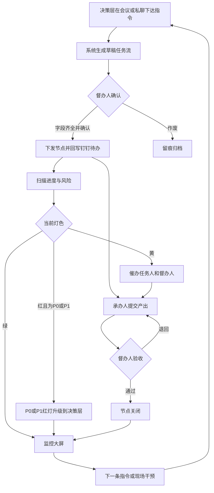

每一环过门槛后才进入下一环。

| 环节 | 进入条件 | 离开时留下的结果 |
| --- | --- | --- |
| 捕获 | 已授权的一场听记，或点名机器人、转发进指令通道的消息 | 原文片段、发言人、来源、接收时间 |
| 成稿 | 这句话被判定为决策或提议 | 草稿任务流。闲聊不建任务 |
| 确认 | 每个节点都有任务人、计划产出、截止时间、优先级 | 指令变为已确认。缺任何一项都停在草稿 |
| 下发 | 刚刚完成确认 | 每个节点一条钉钉待办。P0 同时应用内 DING |
| 执行 | 节点已下发 | 进度记录和一份提交物 |
| 验收 | 已有提交物 | 通过则节点关闭；退回则回到执行 |
| 管控 | 节点已下发且未关闭 | 红黄绿、风险事件、催办记录 |
| 大屏 | 指令已确认 | 四项指标、红黄列表、未来 7 天到期。草稿不进入 |

P3 观察项走同一条执行环，管控环只把它放进周报，不发即时催办。

## 业务流图

下面按角色看同一条业务从左到右怎么交接。大屏只读；改派、改期、验收发生在任务详情或钉钉卡片上。

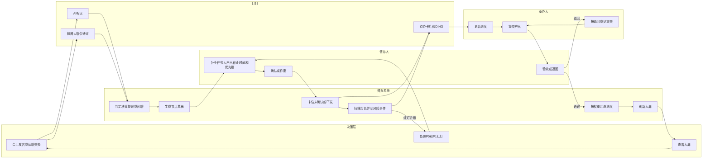

业务对象也沿这条流往下长。一条发言先变成指令，确认后才长出可以执行的节点和产出；风险事件只挂在已下发的节点上。

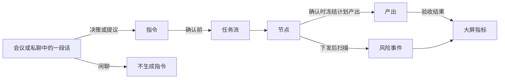

任务流在成稿时分成两轨，首期用同一套确认和验收：

- 交办型：1 到 3 个节点，截止在当天或本周。
- 战役型：节点多、周期长。依赖和关键路径放到下一阶段，首期仍要求每个节点有任务人和产出。

## 流程图

### 1. 捕获并生成草稿

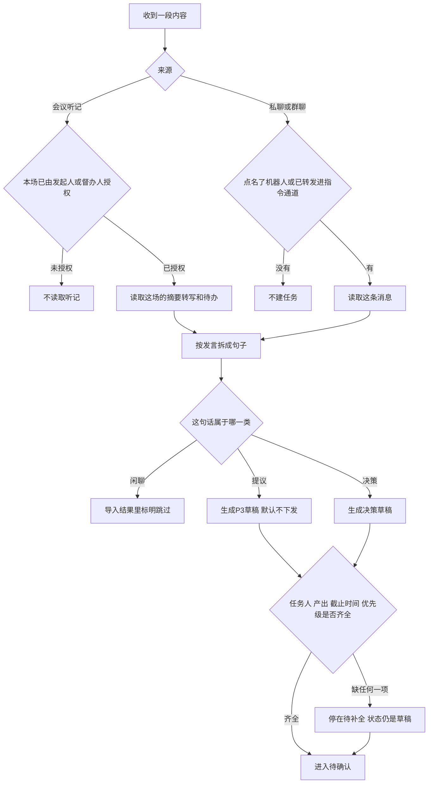

同一场听记、同一段原文只生成一次。再次导入时打开已有草稿，不另建一条指令。

用词给出优先级初值，确认人可以改：

| 听到的说法 | 初值 | 下发后的钉钉待办优先级 |
| --- | --- | --- |
| 马上、立刻、务必、今天、当天 | P0 立即办 | 40 紧急，并应用内 DING |
| 尽快、本周、抓紧 | P1 本周必达 | 30 较高，提前 1 天提醒 |
| 明确要办、没有上述用词 | P2 按期推进 | 20 普通，提前 3 天提醒 |
| 有空、后续看看、再议、不急 | P3 观察项 | 10 较低，只进周报 |

声纹或原句里的人名只作为任务人候选。对不上通讯录时，节点留空，等确认人指定。系统不替决策层猜一个任务人后直接下发。

### 2. 确认并下发

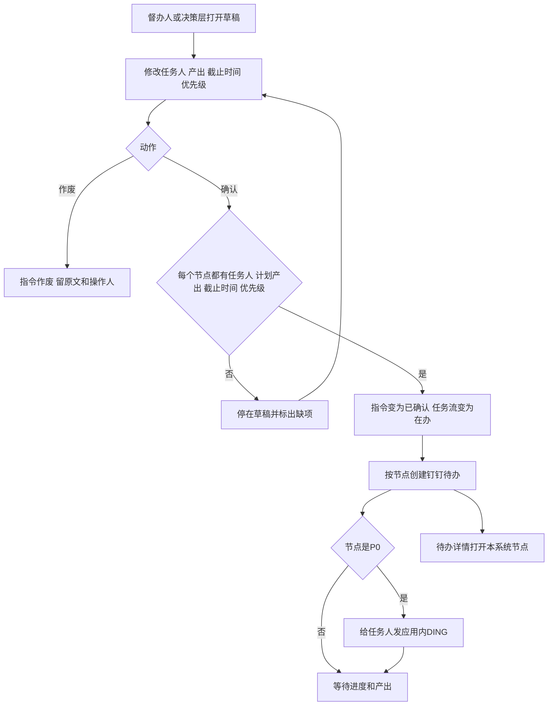

待办的业务编号用本系统节点编号。承办人在钉钉里把待办点成完成，只记一条信号，节点仍等待验收。

### 3. 执行并验收

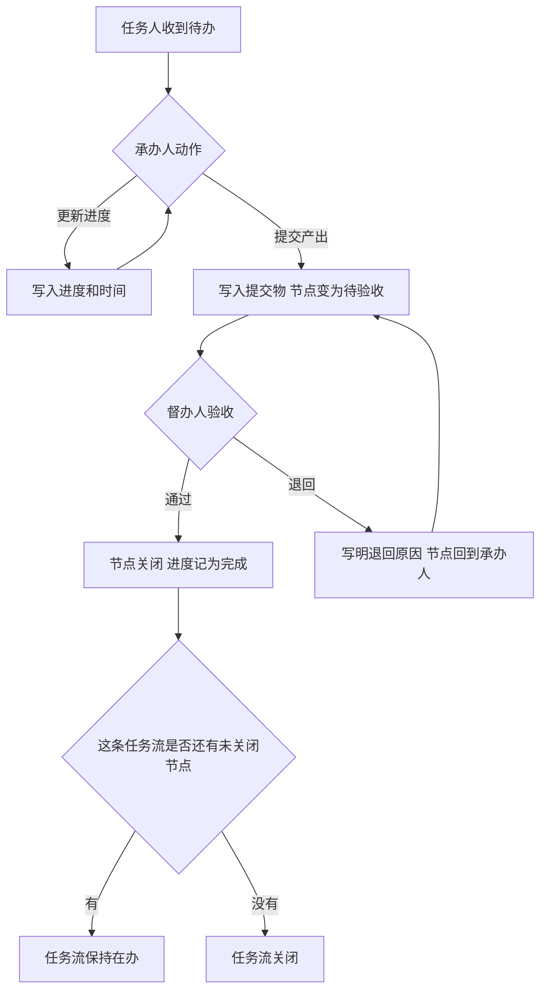

节点完成以验收通过为准。退回后 24 小时内没有重新提交，该节点转红。

### 4. 风险扫描与大屏

扫描只看已确认、已下发、尚未验收的节点。草稿是灰灯，不产生风险事件，也不进入红黄数量。

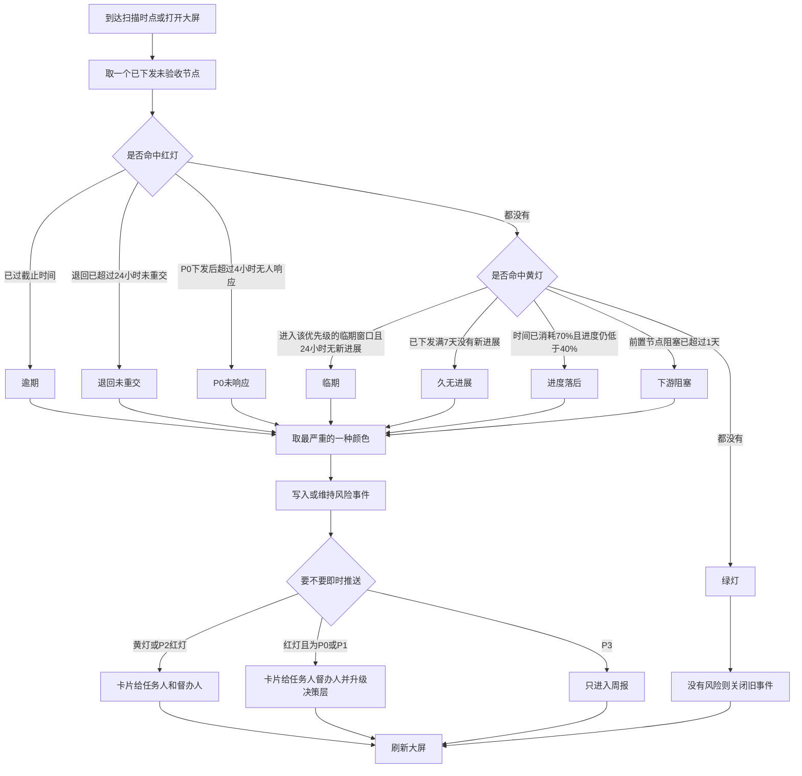

临期窗口：P0 为截止前 4 小时，P1 为 1 天，P2 为 3 天，P3 为 7 天。P0 超过 4 小时没有任何进度或产出，直接按红灯「未响应」处理。

进度落后这一条在时间消耗未到 70% 前不亮黄灯，避免刚下发的节点因为进度还是 0 就被预警。满 7 天仍无进展，走「久无进展」。前置节点阻塞的规则已经定下来；首期界面先不配置依赖，数据里有前置节点时才命中。

同一节点可以同时命中多条规则。屏幕上显示最严重的颜色，顺序是红、黄、绿、灰。催办只在规则第一次命中时推送，规则消失后关闭事件。

大屏回答四件事，并且只读。

| 指标 | 算法 |
| --- | --- |
| 在办指令数 | 已确认、任务流尚未全部验收的指令 |
| 按期率 | 按时验收节点数，除以「已验收节点数 + 当前逾期且未验收节点数」。还没有这类节点时显示暂无 |
| 红黄数量 | 已下发未验收节点里，当前为红或黄的数量。灰灯不计入 |
| P0 未响应数 | 仍开放的「P0 未响应」风险事件 |

中部列出红黄节点，点进去能看到任务流、任务人、产出和原文。侧栏列出未来 7 天内到期、尚未验收的节点。部门负荷和逾期趋势放到下一阶段，避免首期把指挥屏做成报表集。

任务流进度按节点权重汇总，不用「完成条数 / 总条数」。验收通过的节点进度记满。

## 交互图

### 会议听记进入草稿

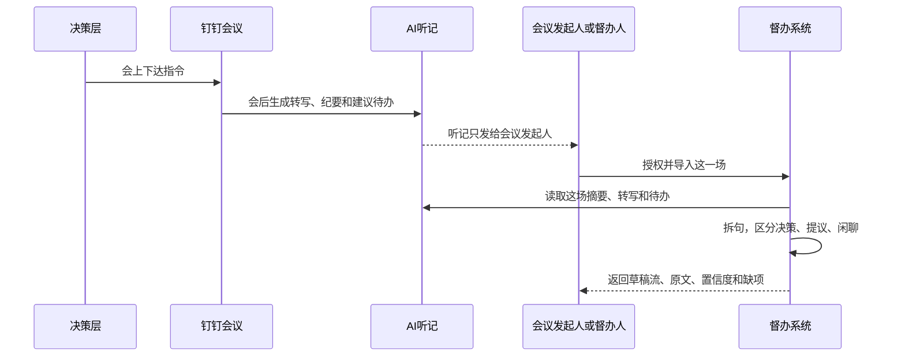

未授权时，系统不拉取这场听记，也不提供「导入全部会议」。

### 私聊或群聊进入草稿

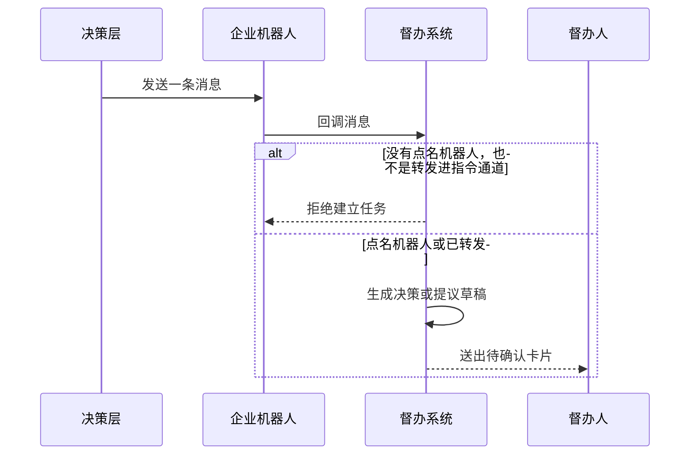

普通闲聊、没有点名的单聊，都不进入模型成稿。

### 确认并下发

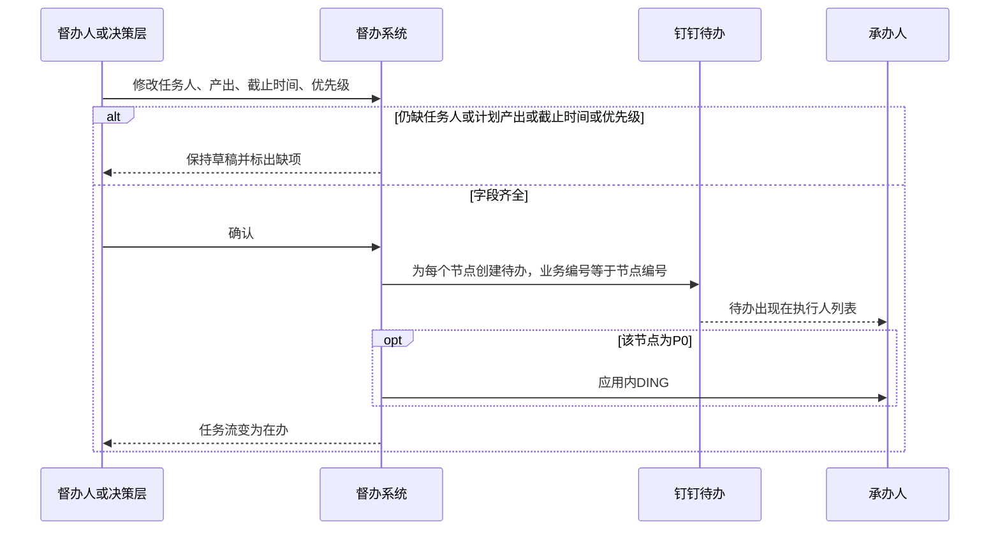

### 提交产出并验收

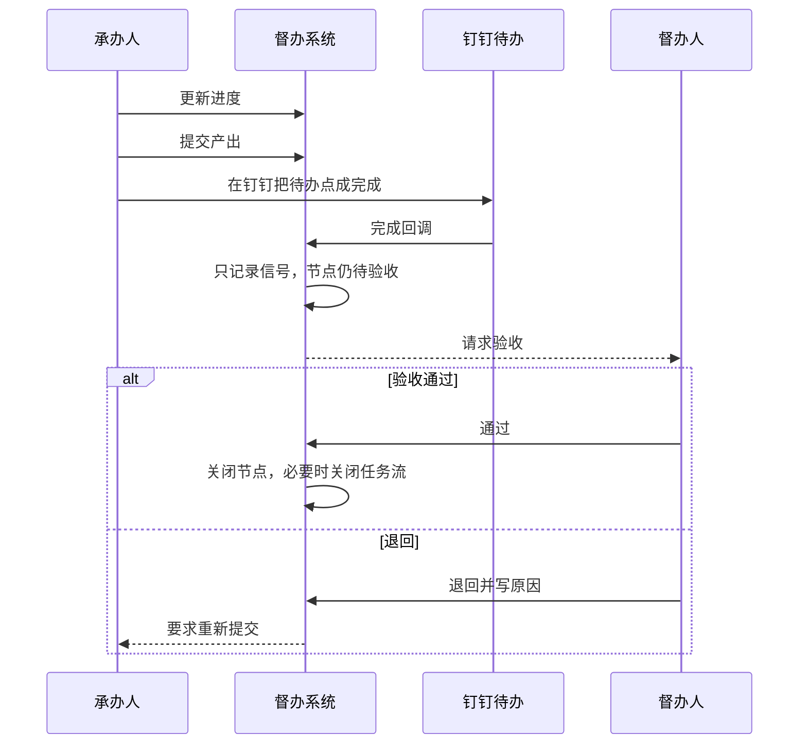

### 预警、升级和大屏

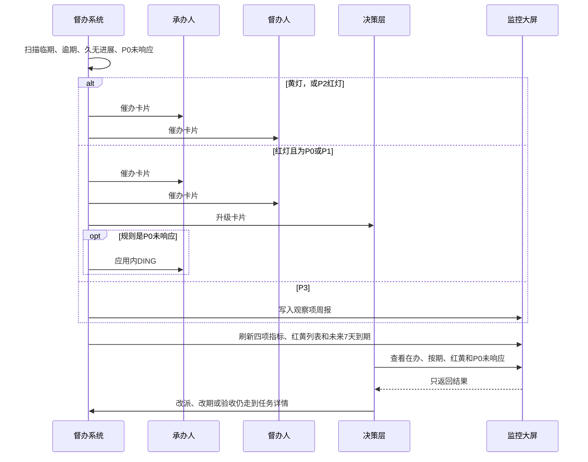

升级对象优先是这条指令的发言人。发言人对不上决策层账号时，发给决策层角色。每次催办都留下规则、接收人和时间。

## 状态如何配合闭环

指令只有三种状态。确认之前可以改，确认之后只能沿着已下发的节点往下走。

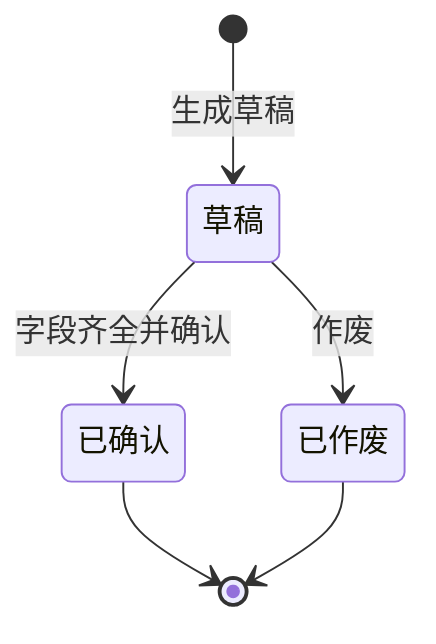

节点跟着执行环走。钉钉待办被点完成时，节点状态不变。

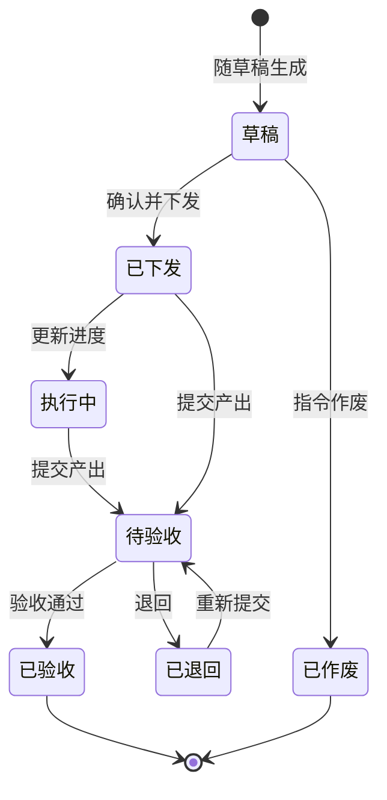

产出单独走验收，避免和「人有没有点完成」混在一起。

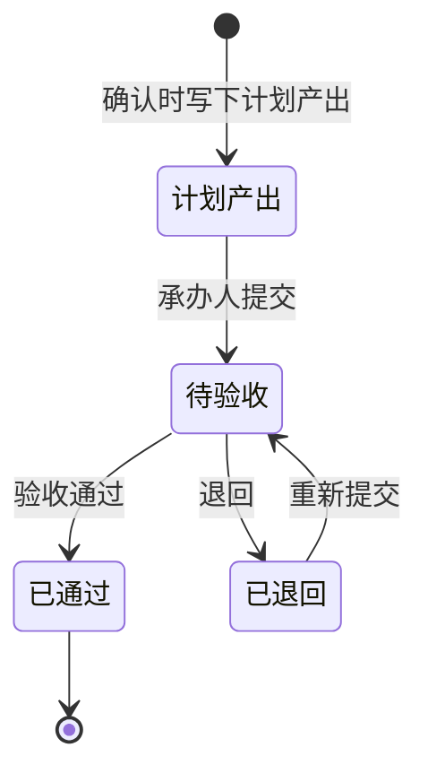

风险事件随扫描出现和关闭。P3 会记事件，但即时推送标记为否。

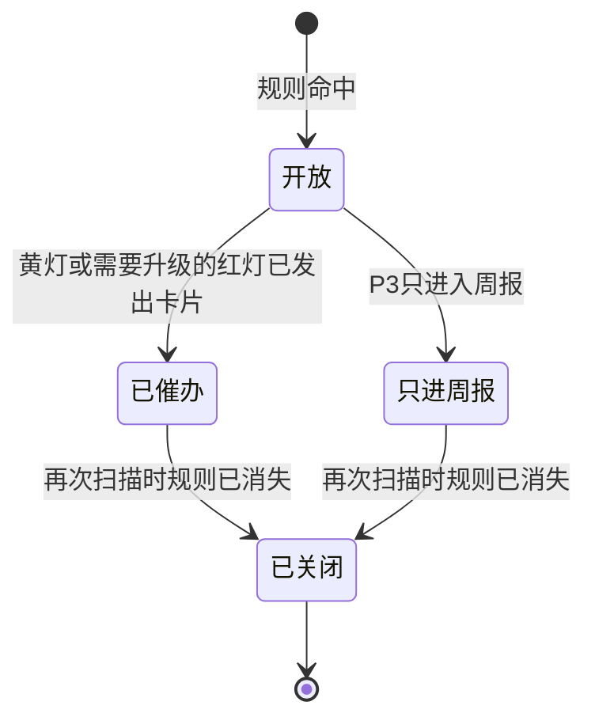

## 首期这条闭环做到这里

首期交付的就是上面这张闭环里的实线路径：

- 导入一场听记，或接收一条点名、转发的交办，生成可修改的草稿。
- 确认卡片上改任务人、产出、截止时间和 P0–P3，通过后下发钉钉待办。
- 承办人交产出，督办人验收或退回。
- 临期、逾期、久无进展、P0 未响应四条规则会写风险并按灯色推送。退回超过 24 小时未重交，按红灯定义一并亮起。
- 一页大屏给出在办指令数、按期率、红黄数量、P0 未响应数，以及红黄列表和未来 7 天到期。

下一阶段再接上的部分，不改变这条闭环的出入口：按授权自动收听记、战役型依赖和关键路径、部门负荷、逾期趋势、催办升级链的更多层级。考评计分、把部门节点再拆给执行人，放在更后面，避免刚开始就把闭环绑进考核。

首期不做通用审批流、项目预算和甘特图编辑器，也不在未确认时自动派工或自动考核，更不把全部单聊送去成稿。
